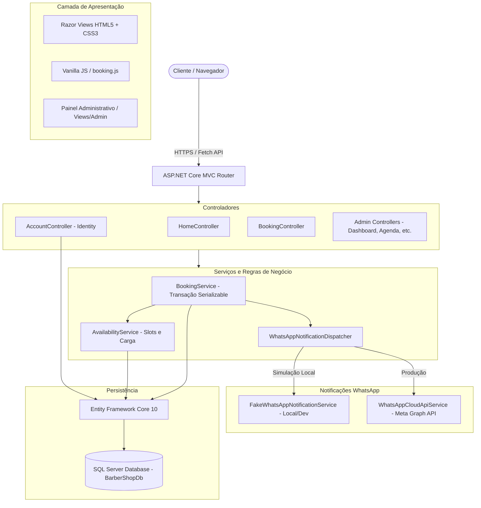

# BarberShop - Sistema Web Premium de Gestão e Agendamento


-brightgreen?style=for-the-badge&logo=checkmarx)

Sistema web completo para gerenciamento de barbearias sofisticadas, com agendamento online inteligente em 5 etapas, autenticação por número de celular via **ASP.NET Core Identity**, painel administrativo de gestão com métricas financeiras, controle atômico de concorrência com transações serializáveis e integração transacional com a **WhatsApp Business Cloud API** oficial da Meta (com modo de simulação local integrado para desenvolvimento sem custos).

---

## 1. Identidade Visual Premium

O design system do sistema foi inspirado em barbearias clássicas de luxo e alfaiatarias europeias:

- **Preto Carvão:** `#111111` (Predominante, elegância e profundidade)
- **Grafite Escuro:** `#1C1C1C` / `#202020` (Cards e superfícies de destaque)
- **Dourado Champanhe:** `#C8A96B` / `#FFE8A3` (Detalhes, botões nobres e destaques)
- **Branco Suave:** `#F5F3EE` (Tipografia com alto conforto de leitura)
- **Cinza Nobre:** `#A6A6A6` (Legendas, badges e informações secundárias)
- **Favicon Vetorial SVG:** Ícone da aba em alta definição com coroa real, barber pole e letra "B" em dourado metálico.

---

## 2. Arquitetura da Aplicação

O projeto adota uma arquitetura monolítica modular organizada por responsabilidades, priorizando código limpo, sustentável e acessível tanto para desenvolvedores experientes quanto juniores.



---

## 3. Principais Funcionalidades

### 🌟 Para o Cliente
1. **Landing Page Institucional:**
   - Apresentação visual da barbearia com galeria de serviços, equipe de mestres barbeiros e diferenciais (toalha quente, visagismo, open bar cortesia).
   - Catálogo de serviços com preços e durações sincronizados dinamicamente do banco de dados.
2. **Cadastro e Login Simples com Celular (LGPD):**
   - Autenticação via **Número de Celular com DDD** e **Senha** criptografada via ASP.NET Core Identity.
   - Aceite obrigatório dos Termos de Uso e Política de Privacidade.
   - Consentimento explícito para recebimento de mensagens transacionais no WhatsApp com carimbo de data/hora (`WhatsAppConsentDate`).
   - Normalização automática de números telefônicos para o padrão internacional E.164.
3. **Agendamento Online em 5 Etapas:**
   - **Etapa 1 (Serviço):** Cabelo (30m), Cabelo + barba (60m), Apenas barba (30m), Cabelo + sobrancelha (40m).
   - **Etapa 2 (Profissional):** Seleção de barbeiro específico ou **"Qualquer profissional disponível"**. O sistema realiza balanceamento automático escolhendo o barbeiro com menor número de agendamentos no dia.
   - **Etapa 3 (Data):** Calendário dinâmico que impede datas passadas ou dias de folga da barbearia.
   - **Etapa 4 (Horário):** Cálculo de horários livres considerando duração, expediente de cada barbeiro, intervalos de almoço e folgas.
   - **Etapa 5 (Confirmação):** Resumo detalhado, campo de observações, garantia de preço histórico e confirmação instantânea.
4. **Painel do Cliente:**
   - Visualização dos agendamentos futuros e histórico de atendimentos.
   - Cancelamento com liberação automática de horários até o limite de antecedência configurado.

### 🛡️ Para o Administrador (Dono da Barbearia)
1. **Dashboard Executivo:**
   - Indicadores de faturamento estimado e faturamento recebido por período (Hoje, Semana, Mês, Ano).
   - Quantidade de agendamentos confirmados, realizados e cancelados.
   - Ranking de serviços mais agendados e distribuição de carga por barbeiro.
2. **Gestão da Agenda:**
   - Visualização por data e filtros de status.
   - Edição de horários, reatribuição de barbeiro e cancelamento administrativo.
   - Finalização de atendimento com confirmação de pagamento presencial.
3. **Gestão de Serviços:**
   - Cadastro, edição, ativação e desativação de serviços.
   - *Preservação de histórico:* Reajustes de preços ou tempos de atendimento não alteram agendamentos já realizados.
4. **Gestão da Equipe de Barbeiros:**
   - Cadastro de profissionais com especialidades e contato.
   - Configuração de expediente individual por dia da semana e intervalos de almoço.
   - Lançamento de folgas, férias e bloqueios administrativos na agenda.
5. **Configurações Gerais & Auditoria de WhatsApp:**
   - Parametrização dos horários da barbearia, antecedência mínima para agendar e cancelar.
   - Monitor de notificações WhatsApp com payload completo, ID da Meta, status de envio e botão de retentativa manual.
   - Chave de alternância entre o **Modo de Simulação Local** e a **Meta Cloud API Oficial**.

---

## 4. Estrutura de Pastas da Solução

```text
BarberShop/
├── BarberShop.slnx                     # Solução moderna .NET 10
├── README.md                           # Documentação técnica completa
├── .gitignore                          # Ignora bin/, obj/, logs e arquivos locais
├── BarberShop/                         # Projeto Web ASP.NET Core MVC
│   ├── Controllers/
│   │   ├── HomeController.cs           # Landing page institucional
│   │   ├── AccountController.cs        # Login e cadastro com celular (LGPD)
│   │   ├── BookingController.cs        # Wizard de agendamento em 5 passos
│   │   ├── ClientController.cs         # Área restrita do cliente
│   │   ├── WebhookController.cs        # Endpoint de webhook oficial da Meta
│   │   └── Admin/
│   │       ├── DashboardController.cs  # Métricas e KPIs financeiros
│   │       ├── AppointmentsController.cs # Painel de agendamentos da equipe
│   │       ├── ServicesController.cs   # Catálogo e reajuste de serviços
│   │       ├── BarbersController.cs    # Gestão de barbeiros e escalas
│   │       ├── ClientsController.cs    # CRM de clientes
│   │       └── SettingsController.cs   # Configurações e WhatsApp
│   ├── Data/
│   │   ├── ApplicationDbContext.cs     # Contexto EF Core com índices e Fluent API
│   │   ├── SeedData.cs                 # Carga inicial automatizada
│   │   └── Migrations/                 # Migrações geradas pelo EF Core
│   ├── Models/
│   │   ├── ApplicationUser.cs          # Cliente com dados de contato e consentimento
│   │   ├── Barber.cs                   # Profissional barbeiro
│   │   ├── BarberWorkingHour.cs        # Expediente e almoço
│   │   ├── BarberTimeOff.cs            # Folgas, férias e bloqueios
│   │   ├── Service.cs                  # Catálogo de serviços
│   │   ├── Appointment.cs              # Agendamento com snapshot de preço e tempo
│   │   ├── BusinessSettings.cs         # Configurações da barbearia e Meta API
│   │   ├── WhatsAppNotification.cs     # Registro e auditoria de mensagens
│   │   └── Enums/                      # Enums de status e tipos
│   ├── Services/
│   │   ├── AvailabilityService.cs      # Algoritmo de slots e balanceamento
│   │   ├── BookingService.cs           # Transações Serializable anti-concorrência
│   │   └── Notifications/              # Dispatcher e serviços de WhatsApp
│   ├── ViewModels/                     # Modelos fortemente tipados para telas
│   ├── Views/                          # Razor Views responsivas e estilizadas
│   │   ├── Home/
│   │   ├── Account/
│   │   ├── Booking/
│   │   ├── Client/
│   │   ├── Admin/                      # Views exclusivas da área administrativa
│   │   └── Shared/
│   ├── wwwroot/
│   │   ├── css/                        # site.css e admin.css com design luxo
│   │   ├── js/                         # booking.js e site.js
│   │   ├── images/                     # Logotipo e brasão oficial
│   │   ├── favicon.svg                 # Favicon vetorial de alta definição
│   │   └── favicon.ico                 # Favicon multi-resolução
│   ├── Program.cs                      # Configuração de serviços e rotas
│   └── appsettings.json                # Configurações de banco e parâmetros
└── BarberShop.Tests/                   # Projeto de Testes xUnit
    ├── AuthenticationTests.cs          # Validações de cadastro e unicidade de celular
    ├── BookingAndAvailabilityTests.cs  # Concorrência, slots e cancelamento
    ├── AdminManagementTests.cs         # Preços históricos e desativação
    ├── WhatsAppNotificationTests.cs    # Consentimento e simulação
    └── Helpers/TestHelper.cs           # Banco em memória e factories de teste
```

---

## 5. Instruções de Instalação e Execução

### Pré-requisitos
- **.NET 10 SDK** instalado ([Download .NET 10](https://dotnet.microsoft.com/download)).
- **Microsoft SQL Server** (LocalDB, SQL Express ou SQL Server padrão).
- **Git** instalado.

### 1. Clonar o Repositório
```bash
git clone https://github.com/Luskinha01-cyber/BarberShop.git
cd BarberShop
```

### 2. Restaurar Dependências
```bash
dotnet restore
```

### 3. Aplicar as Migrações do Banco de Dados
O Entity Framework criará automaticamente o banco `BarberShopDb` no SQL Server LocalDB:
```bash
cd BarberShop
dotnet ef database update
```

### 4. Executar o Projeto
```bash
dotnet run --launch-profile "http"
```

Acesse no navegador:
👉 **http://localhost:5296**

---

## 6. Credenciais de Acesso de Demonstração

| Perfil | Identificador / Login | Senha Padrão | Observações |
| :--- | :--- | :--- | :--- |
| **Administrador (Proprietário)** | `admin@barbershop.com` | `Admin@BarberShop2026!` | Acesso total a configurações, faturamento e agenda |
| **Cliente de Teste** | `5511978664387` | *(Definida no cadastro)* | Pode agendar e consultar histórico |

*(Para cadastrar novos clientes, clique em **Cadastre-se** e informe seu nome e número de celular).*

---

## 7. Configuração da WhatsApp Cloud API Oficial

Por padrão, a aplicação inicia em **Modo de Simulação Local**, salvando o disparo das mensagens diretamente no banco de dados e exibindo-as no painel do administrador, sem custo ou necessidade de contas de desenvolvedor da Meta.

Para conectar a **Meta Cloud API oficial** em produção:
1. Acesse o [Meta for Developers](https://developers.facebook.com/) e crie uma aplicação comercial.
2. Adicione o produto **WhatsApp Business Platform**.
3. No painel da Meta, copie o `Phone Number ID`, `WhatsApp Business Account ID` e gere um `Access Token do Sistema`.
4. Entre no painel da barbearia (`http://localhost:5296/Admin/Settings`).
5. Cole as credenciais, desmarque a opção **Modo de Simulação Local** e clique em **Salvar Configurações**.
6. A URL para receber notificações de status da Meta é:
   `https://seu-dominio.com/api/webhook/whatsapp` com token de verificação `BarberShopSecretToken2026`.

---

## 8. Testes Automatizados

O sistema conta com 13 testes unitários e de integração cobrindo fluxos críticos de negócio:

```bash
dotnet test
```

### Resultados da Execução:
```text
Execução de teste para BarberShop.Tests.dll (.NETCoreApp,Version=v10.0)
Total de Testes: 13
Aprovados:       13 (100%)
Com Falha:       0
Ignorados:       0
Tempo Total:     1.1 segundos
```

- [x] Cadastro de cliente e atribuição da role de cliente.
- [x] Rejeição de número de celular duplicado.
- [x] Rejeição de credenciais inválidas no login.
- [x] Agendamento válido com cálculo exato de término e disparo de WhatsApp.
- [x] Rejeição de sobreposição de horários para o mesmo barbeiro.
- [x] Dois barbeiros atendendo simultaneamente no mesmo horário.
- [x] Rejeição de agendamentos para datas e horários passados.
- [x] Cancelamento de agendamento liberando o horário imediatamente para outro cliente.
- [x] Balanceamento de carga para a opção "Qualquer profissional disponível".
- [x] Preservação do preço e duração históricos em agendamentos anteriores após reajuste de preço.
- [x] Desativação de profissional preservando histórico de atendimentos passados.
- [x] Registro da notificação simulada com payload formatado.
- [x] Bloqueio de envio de notificação caso o cliente não tenha concedido consentimento.

---

## 9. Licença

Este projeto é disponibilizado sob a licença [MIT](LICENSE).
